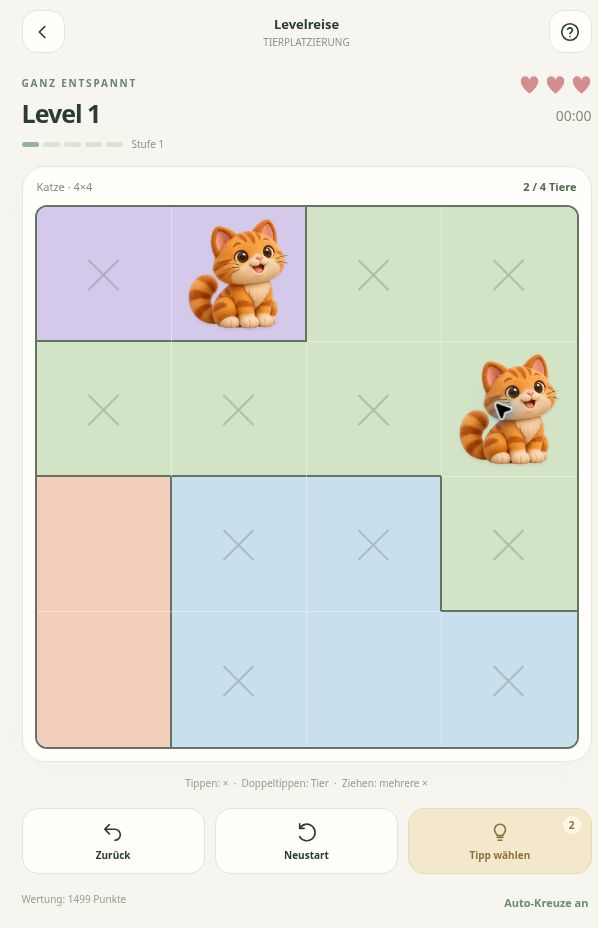

# ZooPit 🐾

**Kleine Tiere. Große Logik.** Eigenes werbefreies Tier-Logikspiel für Android, entwickelt mit Tim und seinen Ideen.

## Installieren und spielen

Die installierbare APK findest du unter **[Releases](https://github.com/Tim-Gurke/ZooPit/releases/latest)**. APK herunterladen, öffnen und die Installation für den verwendeten Browser beziehungsweise Dateimanager erlauben.

**Android 7.0 oder neuer.** Kein Konto für die Offline-Rätsel erforderlich. Nach der Installation kannst du Levelreise, freies Spiel und Zufallsmix ohne Internet spielen.

## Das steckt drin

- 400 eigene, auf Eindeutigkeit und logische Lösbarkeit geprüfte Rätsel; 250 feste Kampagnenlevels.
- Raster **4×4 bis 10×10**, bunte Pastellgebiete und eigene Tierfiguren in verspielter 3D-Optik.
- Katze, Hund, Pferd, Krebs, Axolotl, Ameise, Hochlandrind, Ziege und Huhn. Pro Rätsel wechselt die Tierart automatisch.
- Schwierigkeit in Wellen: **1, 2, 3, 4, 5 – und wieder 1**.
- Einmal tippen für Kreuze, doppeltippen für Tiere; ziehen markiert mehrere Felder.
- Drei Fehlversuche, dann dasselbe Rätsel neu starten.
- Automatische Kreuzmarkierung ein-/ausschaltbar; optional nummerierte Farbgebiete.
- Pro neuem Rätsel ein Tipp. Ungenutzte Tipps werden nach dem Lösen gesammelt. Wahlweise einen Schritt erklären lassen oder ein Tier richtig setzen.
- Rückgängig, automatische Speicherung sowie Export und Import des Spielstands.
- Geräusche und ruhige Hintergrundmusik jeweils separat ein-/ausschaltbar und regelbar.
- **ZooPit-iade:** Freunde per Code einladen, 5/10/15/20 gemeinsame Rätsel, Ergebnisliste. Gesammelte Tipps sind erlaubt und kosten Punkte.

## Spielregeln

Genau ein Tier pro Reihe, Spalte und Farbgebiet. Tiere berühren sich auch diagonal nicht. Kreuze sind eigene Notizen und kosten keine Fehlversuche.

Neustarts stellen die drei Versuche wieder her; bereits verbrauchte Tipps, Fehler und Wertungszeit bleiben erhalten. Wiederholte Kampagnenlevels erzeugen keine weiteren Tippgutschriften.

Normale Rätsel zählen die aktive Spielzeit. Im Wettbewerb läuft die Zeit ab Beginn eines Rätsels bis zur Abgabe weiter. Es gibt kein Zeitlimit.

## Online und Datenschutz

Die Offline-Modi funktionieren vollständig auf dem Gerät. Für Freundesrunden werden Spitzname, zufällige Gerätekennung, Spielverlauf und Ergebnisse an den Wettbewerbsdienst übertragen. Die Liste ist innerhalb der jeweiligen Runde per Einladungscode erreichbar. Keine Werbung, keine Werbe-SDKs, keine Analyse-SDKs und kein Zugriff auf Kontakte oder Standort.

Wettbewerbsdienst und Browserfassung: **[ZooPit](https://zoopit-freundesrunde.extraordinarygrove.chatgpt.site/game/)**.

Eine exportierte Sicherung enthält auch deine Wettbewerbskennung. Bewahre sie privat auf.

## Entwicklung

Die App nutzt einen schlanken nativen Android-Rahmen und lokal mitgelieferte HTML-/JavaScript-Spielinhalte. Alle Rätsel und Bilder liegen in der APK; sie werden beim Offline-Spielen nicht heruntergeladen. Die Musik wird lokal synthetisiert.

Java 17 mit keytool, Python 3 und Node.js werden benötigt. Dann im Projektverzeichnis:

    python3 scripts/bootstrap_android.py
    node tests/engine.cjs
    python3 scripts/build_android.py

Die Ausgabe liegt unter releases/. Signierschlüssel werden nur lokal unter .keys/ erstellt und **nicht** in dieses öffentliche Repository übertragen. Für installierbare Updates derselben App muss derselbe private Schlüssel verwendet werden.

Der Ordner online/ enthält den Wettbewerbsdienst mit D1-Schema und Migrationen. Vor Web-Builds bitte python3 scripts/sync_web.py ausführen. Die darin enthaltenen Werkzeugskripte verwalten den vorgesehenen Hosting-Build; Umgebungsdateien und lokale Datenbanken sind ausgeschlossen.

Die Veröffentlichung prüft die bereits signierte APK, ihre enthaltenen Spielinhalte und ihre SHA-256-Prüfsumme. Zusätzlich baut sie die Android-App unabhängig neu, ohne dabei den privaten Signierschlüssel zu verwenden. Veröffentlicht wird die originale, mit dem dauerhaft aufbewahrten Schlüssel signierte APK.

## Prüfstand 0.1.0

- 400 eindeutige Rätsel, zusammenhängende Gebiete und 3.200 gedrehte/gespiegelte Varianten geprüft.
- Jedes Originalrätsel wird durch seine erklärenden Hinweise vollständig gelöst.
- Schwierigkeitswellen, Fehler, Tipps, Punkte und deterministische Wettbewerbsrätsel geprüft.
- Bedienung und Darstellung in Browser-Vorschauen bis herunter zu 360×760 Pixeln geprüft.
- Die APK ist gebaut und ihre Signatur verifiziert. Eine Installation auf einem physischen Telefon wurde in dieser Umgebung nicht durchgeführt.

## Versionsgeschichte

- **0.1.0:** Erste spielbare Fassung mit neun Tierarten, Pastellrätseln, vier Modi, Tippvorrat und getrennten Audioreglern.

Spielkonzept: [docs/Spielkonzept.md](docs/Spielkonzept.md). Eigene Umsetzung mit eigenen Grafiken und Leveldaten; keine Übernahme der Zoodoku-App oder ihrer Originalinhalte.
